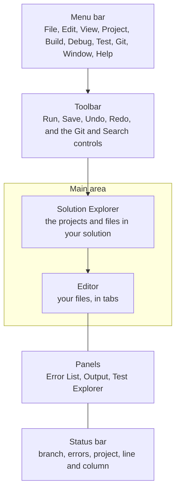

# Course overview

Visual Studio is Microsoft's full-featured IDE, the integrated development environment where you write, build, run, debug, test, and commit code. This course uses Visual Studio on Windows, and it uses the Community edition. Community is free, but it is licensed for learning and a few other uses, and the next lesson, Licensing and work use, explains the limits before you go further. You will write C# in it, and you will work in a solution that holds one or more projects, which is how Visual Studio keeps a program's files together.

If you have used a text editor and a command line before, Visual Studio will feel like a lot of window at first. That is normal. Most of the window is there for a reason, and this course shows you what each part is for before it asks you to use it.

This course is a guided tour, not a reference manual. It takes you from the first launch to the work a developer does every day. You will open a solution, edit code with confidence, build and run it, debug it, run its tests in Test Explorer, carry a change through commit, push, and pull request, and use GitHub Copilot to help you write code and check what it writes.

> **Not a tip, a warning:** the tour is long on purpose, and you do not need to finish it in one sitting. Each chapter stands on its own, and the runner remembers the last lesson you opened, so you can pick up where you left off.

## What the course covers

The course has seven parts and a summary.

1. **Getting around.** Installing, your first launch, accounts, opening solutions, and finding your way around the window.
2. **Editing C#.** Typing and moving code, IntelliSense and Quick Actions, navigating code, and refactoring safely.
3. **Building, running, and testing.** The Build menu and the Error List, running and debugging, and unit tests in Test Explorer.
4. **Source control.** The Git Changes window, branches and stashing, fetch, pull, and push, merge conflicts, pull requests, and history.
5. **Copilot and extensions.** Setting up GitHub Copilot, suggestions and chat, checking what Copilot writes, and extensions.
6. **Working faster.** Settings, keyboard shortcuts, snippets, and extras.
7. **Putting it together.** A capstone that uses everything, when things go wrong, and a summary checklist.

The course ends with an appendix of shortcuts and commands.

## What you need

- A computer running Windows 10 or Windows 11.
- Visual Studio. The setup script checks for it and installs Visual Studio Community with the .NET desktop development workload if it is missing. Chapter 1 explains what that workload is and how to add it by hand.
- A Microsoft account, to sign in to Visual Studio. If you do not have one, Chapter 2 walks you through creating it. It is free, and it is separate from your GitHub account. Visual Studio asks for it when you first launch. It is the account you sign in to Visual Studio with, and it is not the same as the GitHub account that holds your practice repository.
- A personal GitHub account for the practice repository. If you do not have one, Chapter 2 walks you through creating it, and it is free. The course does not use company GitHub Enterprise accounts, because they cannot create the practice repository.
- Basic comfort with the Windows command line. You should know how to open a terminal and type a command. Nothing later needs more than that.
- Patience with the practice repository. It is yours to break, and you will break it on purpose more than once.

> **Copilot and your account:** the chapters on GitHub Copilot use the free tier for practice. The free tier of GitHub Copilot is permitted for learning, and this course uses it for that purpose. Use it only with the sample code in this course, and never for DataBank work. Work at DataBank happens only through company-provided accounts, under the AI Acceptable Use Policy. Each Copilot chapter repeats this, because it matters every time.

## A tour of the window

Before you install anything, it helps to know the names of the parts of the window. The lessons use these names, and the screenshots label them the same way. The diagram shows where each part sits.

The **menu bar** runs across the top. Nearly every command in the course is on it, and the menus are where to look when you are not sure what a command is called.

The **toolbar** sits under the menu bar. It has the buttons you press most: Start (the green arrow that runs your program), Save, Undo and Redo, and the Git controls.

The **Solution Explorer** is the tree on the right. It lists the solution, and under it the projects, and under those the files and folders. Double-click a file and it opens in the editor. You can hide the Solution Explorer from the View menu, and bring it back the same way.

The **editor** is the large space in the middle, where your files open. Each file gets a tab across the top, and you can split the editor to see two files side by side.

The **panels** sit below the editor. The Error List shows the errors and warnings from your last build. Its tab only appears after the first error or warning is caught, so do not worry if you do not see it at first. The Output window shows what the build and the tools are saying, and it has a drop-down that picks which tool's output you are looking at. Test Explorer, which you will meet in Part III, lists your tests and lets you run them. Panels are windows like any other, so you can move, pin, or close them.

The **status bar** is the thin strip at the very bottom. It shows the branch you are on, the number of errors and warnings, the project, and the line and column of your cursor. Click an item in it and you usually get a menu for changing that thing.

The **Command Search** box sits at the top of the window. Press {{Ctrl+Q}} and it opens with the cursor in it. Type a few letters of a command or a setting and press Enter. You will use it constantly, so it is worth learning now.

The full-window picture below shows where each part sits, with the names the lessons use. The status bar and the panel are small at that size, so the two close-ups under it show them larger. Use them to check your own window against the course when a lesson mentions a status bar item or a panel.

*Figure 0.1 - Visual Studio Window Tour*

*Figure 0.2 - Status bar close-up*

*Figure 0.3 - Output panel and panel tabs*

## Command Search in one sentence

Almost everything in Visual Studio is a command, and most of them can be found through Command Search. Press {{Ctrl+Q}}, type a few letters of what you want, and press {{Enter}}.

## How to read the course

Most chapters have three kinds of material, and each is marked when it starts.

- **Lessons** explain a feature and show it. Read them through once, then try the feature while the lesson is still open.
- **Checklists** ask you to do something in Visual Studio and tick it off when it is done. The runner keeps your ticks, so you can stop and come back.
- **Homework** asks you to change a file in the practice solution, in Visual Studio itself. Each homework step shows its starting code, and a worked solution sits behind a spoiler. Try the homework first. The solution is there when you are stuck, and reading it before you try teaches you much less.

This course teaches Visual Studio, so the lesson runner has no code view, no Run button, and no editor. It shows the lessons only. Follow along in Visual Studio itself, and do each homework step there, in your practice folder.

Shortcuts are shown in their Windows form, such as {{Ctrl+Shift+B}}. A keycap that needs two keys in a row, such as Ctrl+K followed by S, is shown as two keycaps. The appendix lists the commands in one place.

---
