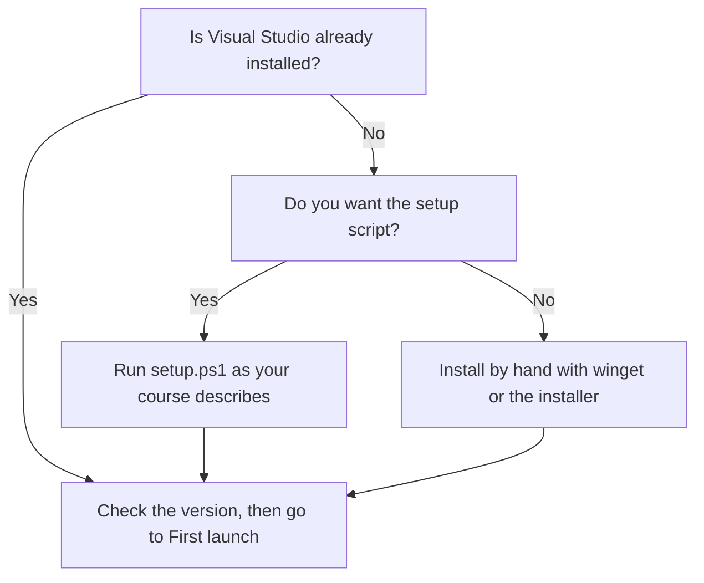

# Installing Visual Studio

There are two ways to get Visual Studio. The setup script does the work for you, and it is the usual route for this course. If you would rather install it yourself, or the script is not available to you, install it by hand. Either way you end with the same edition and the same workload, so the rest of the course works the same.



## With the setup script

The setup script looks for an existing Visual Studio. If it finds one, it checks for the .NET desktop development workload, and it adds the workload if that is missing. If it finds no Visual Studio at all, it installs the Community edition with the workload. Run the script the way your course tells you to.

Installing needs an administrator window, and the script says so if it does not have one. The download is large, so the install can take a long time. Leave the window open until the script finishes.

## By hand

To install by hand, you need two things: the Community edition, and the .NET desktop development workload. The workload is the set of tools for building C# desktop and console programs, and the practice solution needs it.

The quickest route is winget, which is built into Windows 10 and 11. Open PowerShell as Administrator and run this command:

```
winget install --id Microsoft.VisualStudio.Community --exact --override "--quiet --wait --norestart --add Microsoft.VisualStudio.Workload.ManagedDesktop --includeRecommended"
```

The command runs quietly, so you will see only a progress message until it finishes. If you would rather see the installer, use the steps below.

1. Open the Visual Studio download page at visualstudio.microsoft.com and choose the Community download.
2. Run the installer. It opens the Visual Studio Installer.
3. In the Workloads tab, tick .NET desktop development.
4. Choose Install, and wait for it to finish.

Figure 1.1 shows the workload list with .NET desktop development ticked.


*Figure 1.1 - Workload list with .NET desktop development selected*

> **Which edition?** This course uses Visual Studio Community, the free edition. Chapter 0 explains when Community may be used, and it may not be used for DataBank work. Do not install a different edition for this course.

> **Already have Visual Studio?** Any edition works for the course. If it does not have the .NET desktop development workload, the setup script adds it. You can also add it yourself from the Visual Studio Installer, and a later chapter explains how.

## Check the version

Open the Help menu and choose About Microsoft Visual Studio. The edition and version appear at the top of the dialog. Write the version down.

The screenshots in this course were taken in Visual Studio 2026 Community. If your version is different, some menus and dialogs may be in other places, and the lessons will still help you find them.
