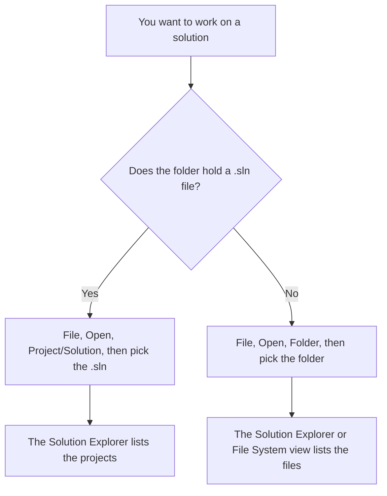

# Opening a solution

A solution file ends in .sln, and it lists the projects that belong together. Opening the solution opens all of them at once in the Solution Explorer, which is how Visual Studio expects you to work.

To open the practice solution, choose File, then Open, then Project/Solution. Find the training-visual-studio-practice folder, pick PracticeSolution.sln, and choose Open.

Figure 3.2 shows the File menu with Open and Project/Solution.

*Figure 3.2 - Open, then Project/Solution, in the File menu*

## Open Folder as an alternative

Sometimes a folder has no solution file, or you only want to look at its files. Choose File, then Open, then Folder, and pick the folder. Visual Studio shows the files in the folder, but it does not know which projects belong together, so it cannot build the code as a solution. For the practice work, open the solution.

## Open Recent

Visual Studio remembers the solutions and folders you have opened. The File menu and the start window both list them, so you can reopen one without finding it again. Removing an item from the list only removes the entry. It does not delete anything on your computer.
