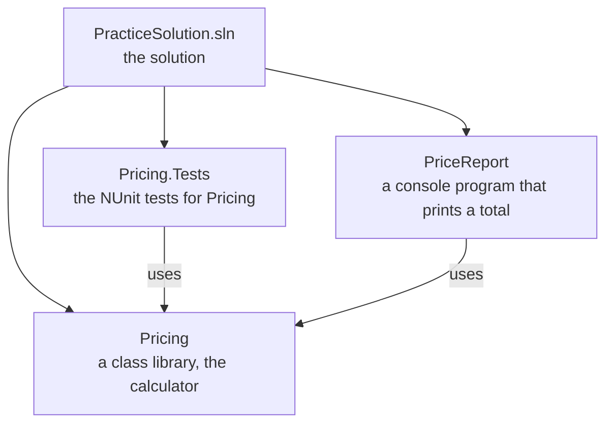

# Solutions and projects

A solution is the container. A project is one program or library inside it. The practice solution holds three projects, and each one builds into its own program or library.

Figure 3.3 shows the same structure in the Solution Explorer.

*Figure 3.3 - The practice solution in the Solution Explorer*

The top line of the Solution Explorer names the solution and says how many projects it holds. Under it, each project appears by name. Open a project's arrow to see its Dependencies, which are the other libraries and packages it uses, and its files.

Two kinds of file matter here. The .sln file is the solution, and it lists the projects. Each project has a .csproj file, which lists that project's settings and its packages. You rarely edit either by hand in this course, but it helps to know what they are when you see them.

> **Two views:** the Solution tab of the Solution Explorer shows projects and their parts. The File System tab shows the same folders as they are on your disk, including files that are not part of any project. Use the Solution tab for the course's work.
