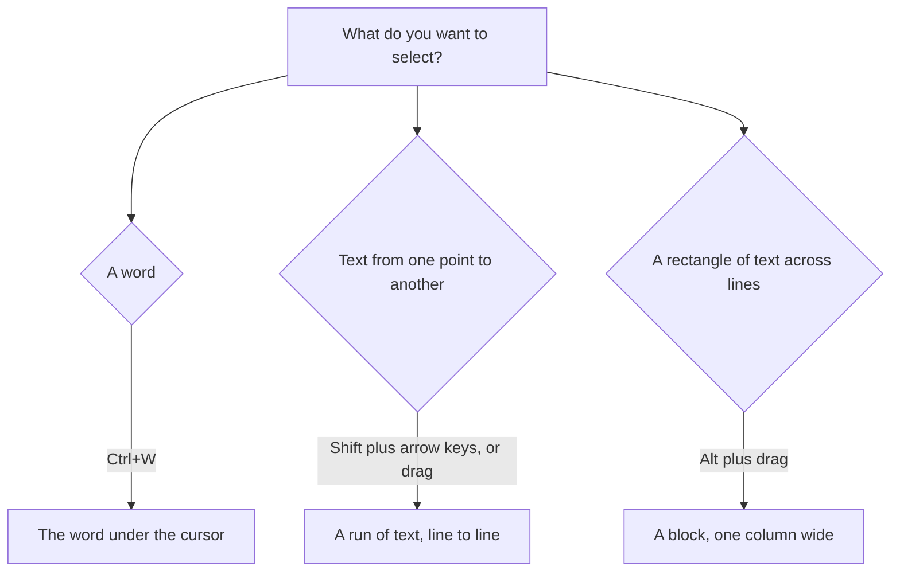

# Selecting text and blocks

Almost every edit starts with a selection. You select the text you want to change, then type over it, delete it, comment it, or format it. Learning the selection keys saves more time than any other single habit in this chapter.

## Selecting text with the keyboard

Hold Shift and press an arrow key to extend the selection one character at a time. Hold Ctrl and Shift together with an arrow key to extend it one word at a time. The selection grows from the cursor, and you can shrink it again by pressing the arrow key in the opposite direction.

## Selecting text with the mouse

Drag across text to select it. Double-click a word to select that word. Click once at the start of a point you want, then hold Shift and click at the end to select everything between the two points.

## Selecting a word with Ctrl+W

Put the cursor on a word and press {{Ctrl+W}}. Visual Studio selects the whole word under the cursor. It is faster than double-clicking when your hands are already on the keyboard.

## Selecting a block

A block selection picks a rectangle of text across several lines, so you can edit the same column on each line at once. Hold {{Alt}} and drag with the mouse. You can also hold Shift and Alt together and press the arrow keys to build the same rectangle from the keyboard.

The flowchart below shows which key to press for each kind of selection.

## Try it

1. Open Pricing/PriceCalculator.cs and find the Average method.
2. Put the cursor on a word in the method, and press {{Ctrl+W}}. The word is selected. Press {{Esc}} to clear the selection.
3. Hold Alt and drag down over the first few letters of three lines in the method. Type a single character. It appears on each selected line.
4. Press {{Ctrl+Z}} to remove the characters, so the file is back to its original state.

## Common mistake

A selection that looks right on screen can start one character too early or end one character too late. If a key then does something unexpected, undo, select again, and check the start and end points before you press the key.
