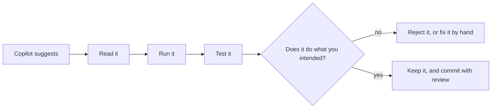

# The review loop

Use the same loop for every suggestion, from the smallest to the largest. The steps are read it, run it, test it, and decide.

Read it first. Ask what each line claims. Does the code match the name of the method and the comment above it? Does it handle the cases the method needs, such as an empty list?

Run it next. Use the Debug menu, or press {{Ctrl+F5}} for a console program, and check the output against values you know. For a method in the Pricing project, call it from PriceReport, or use the debugger from Chapter 10.

Then test it. Write a test yourself, in Pricing.Tests, using inputs you chose and an expected answer you worked out by hand. Run it from Test Explorer, as Chapter 11 showed. A test that fails and points at a real bug is the result you want, because it tells you what to fix.

Finally, decide. If the code does what you intended, keep it, and commit it with the tests together. If it does not, reject the suggestion with {{Esc}}, or fix the code by hand, and run the loop again.

## Try it

Run the loop on one suggestion from Chapter 20, or on any method in the practice solution. Write down what you read, what you ran, and the test you wrote, in three sentences.
