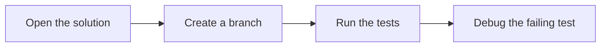
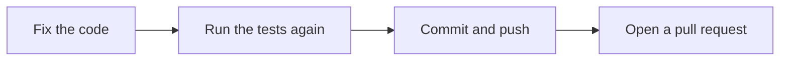

# 25. Capstone: Change, Test, Review

A teammate changed a helper method last night, and the test run this morning has one red test. Nobody has looked at it. The test run is the team's only warning, and it is ignoring it. Your job is to find out why, fix it on a branch, and send the fix for review.

This chapter brings together the work from the whole course: opening a solution, creating a branch, running and debugging a test, committing, pushing, and opening a pull request. Every step uses something you have already learned, so the lessons point back to the chapter that taught it rather than teaching it again.

The workflow looks like this:

The last lesson is homework. You make the fix yourself, and you explain it in the pull request description. Read the lessons in order, and do not skip the checks at the end of each one.
