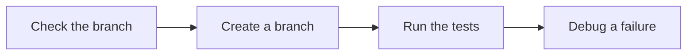
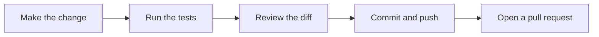

# 28. Checklist and Summary

You have reached the last chapter. Over the course you learned to open a solution, edit and navigate C#, build and debug, run tests, use Git and GitHub, work with Copilot, manage extensions, and set up Visual Studio the way you like it. This chapter gives you a checklist to use on a normal working day, and a summary of the course.

The checklist follows the work from start to finish. Each step names the chapter that taught it, so you can go back when you need a reminder.

